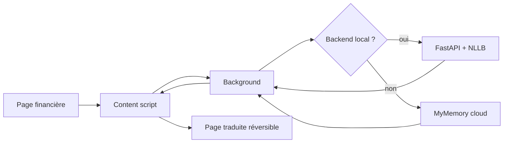

# NkapLingua

[](https://github.com/TSEFACKDEV/safinum-nkaplingua/actions/workflows/ci.yml)
[](LICENSE)
[](https://www.python.org/)
[](#chrome--edge)
[](#firefox)

> **Traduction financière non intrusive en fulfulde, directement dans le navigateur.**

NkapLingua est une extension navigateur autonome qui traduit les interfaces
financières numériques en **fulfulde (Adamawa)** sans modifier le site source
et sans lire les champs sensibles. Elle fonctionne **sans installation Python**
grâce à un service cloud de secours, ou en **100 % local** avec le backend NLLB
fourni dans le dépôt.

Projet préparé pour le **SAFINUM Innovate Challenge 2026** (Yaoundé,
26–28 novembre 2026).

## Aperçu

<p align="center">
  
</p>

<p align="center">
  
</p>

Design system : [`docs/DESIGN.md`](docs/DESIGN.md).

## Livrables

| Livrable | Lien |
|---|---|
| **Vidéo de démonstration** (2 min 19) | [NkapLingua-Demo.mp4](https://github.com/TSEFACKDEV/safinum-nkaplingua/releases/latest/download/NkapLingua-Demo.mp4) |
| **Documentation PDF** | [NkapLingua-Documentation.pdf](https://github.com/TSEFACKDEV/safinum-nkaplingua/releases/latest/download/NkapLingua-Documentation.pdf) |
| **Extension universelle** (Chrome/Edge/Firefox) | [nkaplingua-extension.zip](https://github.com/TSEFACKDEV/safinum-nkaplingua/releases/latest/download/nkaplingua-extension.zip) |
| **Dépôt GitHub** | https://github.com/TSEFACKDEV/safinum-nkaplingua |
| **Démo publique** | https://tsefackdev.github.io/safinum-nkaplingua/demo/ |

> L’extension universelle fonctionne sans installation Python : elle utilise
> le backend local s’il est présent, sinon le service cloud MyMemory avec un
> texte pseudonymisé.

---

## Sommaire

- [Le problème](#le-problème)
- [La solution](#la-solution)
- [Fonctionnalités](#fonctionnalités)
- [Architecture](#architecture)
- [Démarrage rapide](#démarrage-rapide)
- [Chrome / Edge](#chrome--edge)
- [Firefox](#firefox)
- [API](#api)
- [Sécurité et vie privée](#sécurité-et-vie-privée)
- [Données et licences](#données-et-licences)
- [Évaluation](#évaluation)
- [Structure du dépôt](#structure-du-dépôt)
- [Workflow Git](#workflow-git)
- [Roadmap](#roadmap)
- [Contribuer](#contribuer)
- [Licence](#licence)

---

## Le problème

Des millions de Camerounais utilisent le mobile money, mais les frais, les
conditions de crédit, les alertes de sécurité et les procédures KYC restent
souvent en français ou en anglais.

Les traducteurs généralistes ne connaissent pas la terminologie financière et
peuvent modifier un montant, un numéro de compte ou un avertissement. Une
mauvaise traduction dans ce contexte peut coûter de l’argent à l’utilisateur.

## La solution

NkapLingua ajoute une **couche de traduction réversible** à n’importe quelle page
financière :

1. l’utilisateur ouvre sa page mobile money ou sa banque ;
2. il clique sur l’extension ;
3. il choisit le fulfulde ;
4. la page devient lisible ;
5. il peut revenir à l’original à tout moment.

Le site source n’est jamais modifié. Aucune ligne de code n’est ajoutée au
serveur de la banque. L’extension utilise le backend local s’il est disponible ;
sinon, elle bascule sur le service cloud **MyMemory** avec un texte
pseudonymisé. Aucun mot de passe, code PIN, OTP ou valeur de formulaire n’est
lu.

```text
Page financière
      │
      ▼
Content script
  ├─ nœuds texte visibles uniquement
  ├─ exclusion : mots de passe, OTP, PIN, champs de formulaire
  ├─ pseudonymisation : montants, numéros, URLs, emails
  ├─ découpage en phrases courtes
  └─ rendu réversible
      │
      ▼
Background (service worker Chrome / event page Firefox)
  ├─ cache local
  ├─ backend local si disponible (127.0.0.1:8000)
  └─ sinon service cloud MyMemory (texte pseudonymisé)
      │
      ▼
Moteur — NLLB-200 local ou MyMemory
  ├─ traduction français/anglais → fulfulde
  ├─ post-contrôle des jetons et termes critiques
  └─ refus si un montant ou une entité est modifié
```

## Fonctionnalités

- **Extension Manifest V3** pour Chrome/Edge et Firefox 140+.
- **Traduction réversible** : bouton « Restaurer l’original ».
- **Contenu inédit** : test dans le popup ou traduction de la sélection.
- **Mode bilingue** possible pour les termes sensibles.
- **Pseudonymisation** des montants, numéros, URLs et emails avant envoi.
- **Refus sécurisé** si un jeton ou un terme critique manque.
- **Aucune lecture** des mots de passe, codes OTP, PIN ou valeurs de formulaire.
- **Extension autonome** : un seul ZIP, aucun serveur à installer.
- **Backend local optionnel** : mode 100 % local avec NLLB si disponible.
- **Cloud de secours** : MyMemory, avec texte pseudonymisé et consentement
  explicite par le clic de l’utilisateur.
- **CI GitHub Actions** : tests backend mock, lint JS, lint Firefox, scan de
  secrets.

## Architecture



### Stack

| Couche | Technologie |
|---|---|
| Extension | JavaScript, Manifest V3, Shadow DOM |
| Backend | Python 3.10+, FastAPI, Uvicorn |
| Traduction | NLLB-200 distilled 600M (`fuv_Latn`) |
| Tests | Pytest, FastAPI TestClient |
| CI | GitHub Actions |
| Données | Adamawa Fulfulde–French Parallel Corpus, NOODL-1.0 |

---

## Démarrage rapide

### Option A — extension seule (recommandée pour le jury)

Aucun Python, aucun modèle à télécharger.

1. Télécharger `dist/nkaplingua-extension.zip`.
2. Dézipper le fichier.
3. Charger le dossier dans Chrome/Edge ou Firefox (voir ci-dessous).
4. Ouvrir la démo publique :
   **https://tsefackdev.github.io/safinum-nkaplingua/demo/**
5. Cliquer sur l’icône NkapLingua → **Traduire cette page**.

L’extension utilise le backend local s’il tourne, sinon le service cloud
MyMemory. Les montants, URLs et emails sont pseudonymisés avant l’envoi.

### Option B — 100 % local (NLLB)

Prérequis : Python 3.10+, ~3 Go d’espace disque, 8 Go de RAM recommandés.

```bash
cd server
python3 -m venv .venv
source .venv/bin/activate

# Option CPU-only (plus léger sur Linux/Windows) :
pip install torch --index-url https://download.pytorch.org/whl/cpu

pip install -r requirements.txt
NK_DEVICE=cpu uvicorn app:app --host 127.0.0.1 --port 8000
```

Vérifier :

```bash
curl http://127.0.0.1:8000/health
```

Le premier lancement télécharge le modèle NLLB (~2,4 Go). Sur CPU, comptez
plusieurs dizaines de secondes pour la première traduction d’une page.

### Mode maquette (sans modèle)

```bash
cd server
source .venv/bin/activate
NK_MOCK=1 uvicorn app:app --host 127.0.0.1 --port 8000
```

### Page de démo

- en ligne : `https://tsefackdev.github.io/safinum-nkaplingua/demo/`
- en local : `http://127.0.0.1:8000/demo` (si backend lancé)
- dans le dépôt : `demo/index.html`

---

## Chrome / Edge

1. Télécharger `dist/nkaplingua-extension.zip` et le dézipper.
2. Ouvrir `chrome://extensions`.
3. Activer le **mode développeur**.
4. Cliquer sur **Charger l’extension non empaquetée**.
5. Sélectionner le dossier dézippé (celui qui contient `manifest.json`).
6. Épingler **NkapLingua**.
7. Ouvrir la démo publique :
   **https://tsefackdev.github.io/safinum-nkaplingua/demo/**
8. Cliquer sur l’icône → **Traduire cette page**.

> Chrome 149+ bloque le chargement automatique via `--load-extension` dans les
> builds officielles. Le chargement manuel ci-dessus est la voie normale.

## Firefox

Le même ZIP universel fonctionne dans Firefox 140+ :

1. Ouvrir `about:debugging#/runtime/this-firefox`.
2. Cliquer sur **Charger un module temporaire…**.
3. Choisir le `manifest.json` du dossier dézippé.

Alternative de développement :

```bash
./scripts/build-firefox.sh
./scripts/start-firefox.sh
```

Détails et dépannage : [`docs/FIREFOX.md`](docs/FIREFOX.md).

---

## API

### `GET /health`

```json
{"status":"ok","model":"facebook/nllb-200-distilled-600M","mock":false,"loaded":true}
```

### `POST /translate`

```bash
curl -s http://127.0.0.1:8000/translate \
  -H 'Content-Type: application/json' \
  -d '{
    "target": "fub",
    "source": "fr",
    "segments": [
      {
        "id": "s1",
        "text": "Les frais de transfert sont de [[NUM_0]] FCFA.",
        "context": "mobile money"
      }
    ]
  }'
```

```json
{
  "translations": [
    {
      "id": "s1",
      "text": "Fedde jaɓɓorgo nden ko [[NUM_0]] FCFA.",
      "ok": true,
      "reason": null
    }
  ],
  "model": "facebook/nllb-200-distilled-600M",
  "target": "fub"
}
```

Les jetons `[[NUM_n]]`, `[[URL_n]]` et `[[EMAIL_n]]` sont contrôlés : si un
jeton manque ou est dupliqué, `ok` passe à `false` et l’extension conserve
l’original.

---

## Sécurité et vie privée

- `activeTab` + `scripting` : pas d’accès permanent à tous les sites.
- Aucune lecture des valeurs de formulaire, mots de passe, OTP ou cookies.
- Aucun code distant, aucune évaluation dynamique.
- UI en Shadow DOM ; le texte traduit est injecté via `textContent`.
- Montants, numéros, URLs et emails remplacés par des jetons avant traduction.
- Si un jeton ou un terme critique manque, la traduction est refusée.
- Backend local prioritaire, lié à `127.0.0.1`, sans journalisation du texte.
- Mode cloud de secours : texte pseudonymisé envoyé à **MyMemory** ; aucun mot
  de passe, PIN, OTP ou valeur de formulaire n’est lu.
- Aucun code JavaScript distant ; tout le code de l’extension est local.
- CORS local restreint aux origines `chrome-extension://` et `moz-extension://`.

Détails : [`docs/SECURITY.md`](docs/SECURITY.md).

## Données et licences

| Ressource | Licence | Usage |
|---|---|---|
| **NLLB-200 distilled 600M** | CC BY-NC 4.0 | traduction, hackathon non commercial |
| **Adamawa Fulfulde–French Parallel Corpus 1.2** | NOODL-1.0 | évaluation / adaptation |
| **Common Voice Adamawa Fulfulde** | CC0 1.0 | audio optionnel |
| **MyMemory API** | service externe gratuit | mode cloud de secours |
| **Recherches du centre linguistique** | à confirmer | référence orthographique et terminologique |
| **Code NkapLingua** | MIT | réutilisation libre |

> NLLB est autorisé pour ce hackathon non commercial. Pour une exploitation
> commerciale, il faudra un accord ou un autre modèle (par exemple M2M100 MIT
> fine-tuné sur le corpus adamawa).

Détails : [`docs/DATA_LICENSES.md`](docs/DATA_LICENSES.md).

## Évaluation

Le projet distingue :

- **qualité linguistique** : validation par un locuteur natif fulfulde ;
- **sécurité** : 100 % des montants et entités préservés ;
- **contenu inédit** : phrases jamais utilisées pour l’entraînement ;
- **latence** : mesurée sur CPU et GPU.

Protocole et métriques : [`docs/EVAL.md`](docs/EVAL.md).

> Le modèle NLLB est un **baseline**. Les phrases courtes sont nettement plus
> fiables que les phrases longues. Une validation native est indispensable
> avant toute démonstration.

## Conformité SAFINUM

Le règlement officiel du Hackathon Preselection Challenge est analysé
exigence par exigence dans [`docs/COMPLIANCE.md`](docs/COMPLIANCE.md).

| Document | Contenu |
|---|---|
| [`docs/COMPLIANCE.md`](docs/COMPLIANCE.md) | grille 100 points, livrables, écarts |
| [`docs/DESIGN.md`](docs/DESIGN.md) | palette, typographie, espacement, accessibilité |
| [`docs/TECHNICAL.md`](docs/TECHNICAL.md) | architecture, intégration, dépendances, limites |
| [`docs/LANGUAGE_VALIDATION.md`](docs/LANGUAGE_VALIDATION.md) | fulfulde, méthode de validation native |
| [`docs/VIDEO_SCRIPT.md`](docs/VIDEO_SCRIPT.md) | script de la vidéo de 3 minutes |
| [`docs/SUBMISSION_CHECKLIST.md`](docs/SUBMISSION_CHECKLIST.md) | checklist avant soumission |

---

## Structure du dépôt

```text
.
├── extension/              # Manifest V3, content script, popup, icônes
│   ├── manifest.json       # Chrome / Edge
│   └── manifest.firefox.json
├── server/                 # FastAPI + NLLB-200
│   ├── app.py
│   ├── test_api.py
│   ├── requirements.txt
│   └── requirements-ci.txt
├── demo/                   # Page FINAKA fictive
├── data/                   # Glossaire à valider, termes à ne pas traduire
├── docs/                   # Sécurité, licences, évaluation, pitch, Firefox
├── scripts/                # build Firefox, lancement Firefox
├── .github/workflows/      # CI GitHub Actions
└── README.md
```

## Workflow Git

Branches disponibles :

| Branche | Usage |
|---|---|
| `main` | version stable / démo |
| `develop` | intégration des fonctionnalités |
| `klein` | espace de travail Klein |
| `freedy` | espace de travail Freedy |
| `marius` | espace de travail Marius |

Règles simples :

1. Travailler sur sa branche (`klein`, `freedy`, `marius`) ou une branche
   `feature/...` créée depuis `develop`.
2. Faire une PR vers `develop`.
3. `main` ne reçoit que du code validé depuis `develop`.
4. Avant chaque PR :

```bash
NK_MOCK=1 pytest -q server/test_api.py
node --check extension/background.js
node --check extension/content.js
node --check extension/popup.js
```

Conventions de commit : `feat:`, `fix:`, `docs:`, `test:`, `chore:`.

## Roadmap

- [x] Extension Manifest V3 + backend local
- [x] Traduction réversible et test de texte inédit
- [x] Pseudonymisation des montants et entités
- [x] CI GitHub Actions
- [ ] Validation native de 100 phrases finance
- [ ] Glossaire finance validé (`data/glossary.template.csv`)
- [ ] Fine-tuning / adaptation au fulfulde adamawa
- [ ] Mode bilingue pour les contrats
- [ ] Tests end-to-end sur 5 sites financiers réels
- [ ] Packaging Chrome Web Store / AMO

## Contribuer

Les contributions sont bienvenues. Lire
[`CONTRIBUTING.md`](CONTRIBUTING.md) avant d’ouvrir une PR.

## Licence

Le code est sous **MIT** — voir [`LICENSE`](LICENSE).

Les modèles et données gardent leurs licences respectives : NLLB-200
(CC BY-NC 4.0), corpus Adamawa (NOODL-1.0), Common Voice (CC0 1.0).

## Remerciements

- **SAFINUM 2026** — Salon de la Finance Numérique, Yaoundé.
- **CNEF Cameroun** — cadre de réflexion sur la finance numérique.
- **Mozilla Data Collective** — corpus Adamawa Fulfulde.
- **Meta AI** — modèle NLLB-200.
- Les linguistes et locuteurs natifs qui valideront les traductions.

---

<p align="center">
  <strong>NkapLingua</strong> — rendre les frais, les conditions et les alertes
  compréhensibles, sans toucher au site et sans exposer les données sensibles.
</p>
