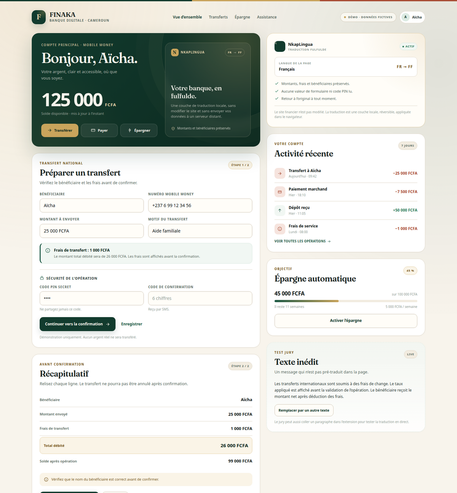
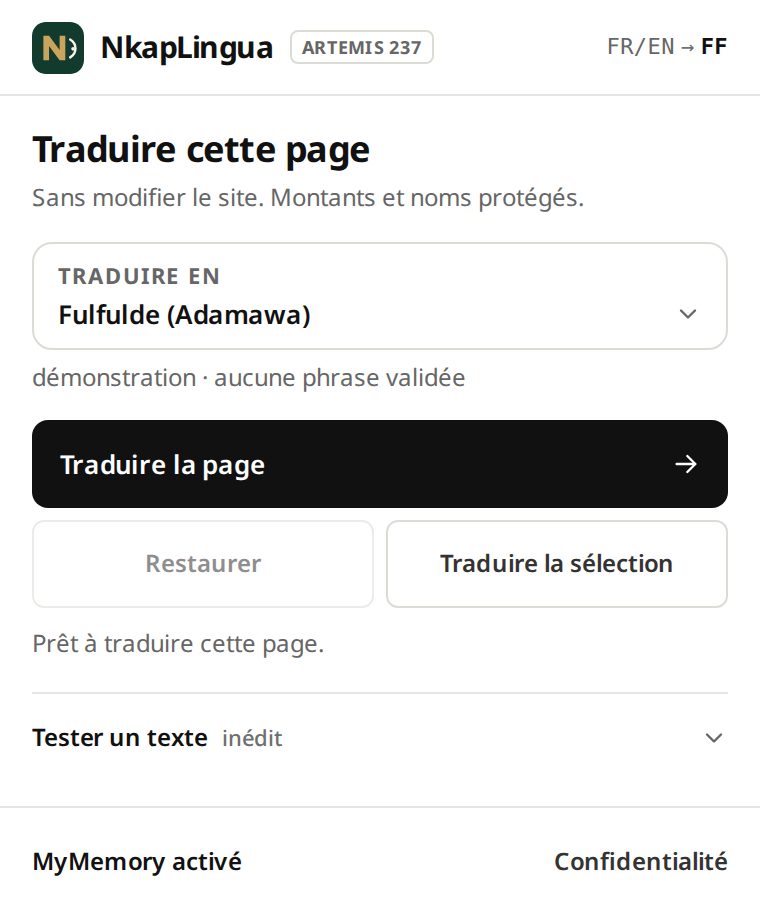
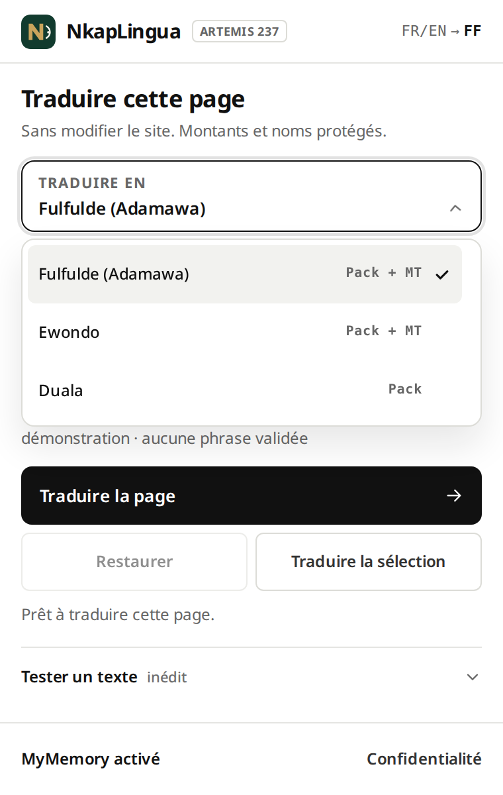
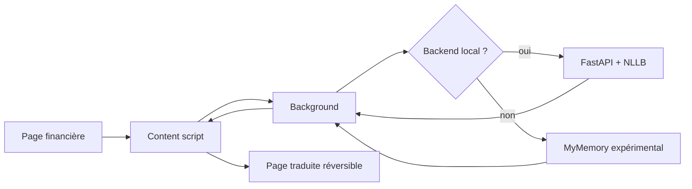

# NkapLingua

[](https://github.com/TSEFACKDEV/safinum-nkaplingua/actions/workflows/ci.yml)
[](LICENSE)
[](https://www.python.org/)
[](#chrome--edge)
[](#firefox)

> **Traduction financière non intrusive en fulfulde, ewondo et duala,
> directement dans le navigateur.**

NkapLingua est une extension navigateur autonome qui traduit les interfaces
financières numériques en **trois langues camerounaises** sans modifier le site
source et sans lire les champs sensibles. Le **fulfulde d’Adamawa** et
l’**ewondo** utilisent un **brouillon MT** `flagship-ai` (NLLB en secours pour
le fulfulde) et un **pack humain** ; le **duala** utilise uniquement un pack
humain. Les packs contiennent des brouillons humains, pas encore des phrases
validées par un panel indépendant.

Le mode « pack » ne demande aucune installation Python. Le backend local
`flagship-ai`/NLLB télécharge les modèles au premier lancement ; le cloud
MyMemory est expérimental, **désactivé par défaut**, opt-in explicite et jamais
utilisé pour l’ewondo. Les phrases critiques (solde, frais, PIN/OTP, etc.) ne
passent jamais par la MT sans pack validé : en mode strict, elles restent en
français. En mode démo SAFINUM, les brouillons humains sont appliqués avec un
badge explicite. Aucun pack n’est encore validé : voir le statut réel
ci-dessous et [`docs/NATIVE_REVIEW_AUDIT.md`](docs/NATIVE_REVIEW_AUDIT.md).

Projet préparé pour le **SAFINUM Innovate Challenge 2026** (Yaoundé,
26–28 novembre 2026).

## État réel au 10 novembre 2026

| Élément | État vérifié |
|---|---|
| Pack fulfulde | **231 entrées** (FR+EN), **0 validée** ; brouillons humains/éditoriaux |
| Packs ewondo / duala | **210** et **203 entrées**, **0 validée** (2 `reviewed` en ewondo) |
| Glossaire finance | 40 termes, **0 validé** |
| Audio | **0 enregistrement** ; 15 phrases sans montant prêtes |
| MT duala (pilote) | **échoué** : répétitions, non utilisable pour le niveau A |
| Test site officiel | **188/188** sur 5 étapes en Chrome et Firefox, 0 non traduit, 0 critique MT, restauration 5/5, 0 erreur ; NLLB seul : 31/192 |
| EN pack-only | **40/44** (4 dates restantes) ; 38/44 avec backend dans l’audit du 9 nov |
| Firefox 159 | recette réelle 5 étapes + EN via XPI de test |
| CI GitHub Actions | **5 jobs verts** sur `develop` |
| Tests | 30 API + 17 contrats + charge/503 + jsdom + taxonomie + harnais Chrome/Firefox |

Le niveau A (solde, frais, PIN/OTP, confirmation, erreurs) ne vient que d’un
pack validé en mode strict ; sans phrase validée, l’original reste affiché
avec un badge « non traduit ». En mode démo SAFINUM, une entrée humaine
`draft`/`reviewed` peut couvrir le niveau A avec le badge « brouillon
humain ». Depuis le 10 novembre, hors démo, les brouillons `draft`/`reviewed`
ne couvrent que le niveau B/C, jamais A, avec un toast « pack non validé ».

Suivi détaillé du lot moteur : [docs/MARIUS_STATUS.md](docs/MARIUS_STATUS.md).

## Aperçu

<p align="center">
  
</p>

<p align="center">
  
  
</p>

Design system : [`docs/DESIGN.md`](docs/DESIGN.md).

Autres états du popup : [test de texte](docs/assets/popup-redesign-test.png),
[confidentialité](docs/assets/popup-redesign-privacy.png),
[erreur](docs/assets/popup-redesign-error.png),
[page large](docs/assets/popup-redesign-wide.png).

## Livrables

| Livrable | Lien |
|---|---|
| **Vidéo de démonstration** (2 min 19) | [NkapLingua-Demo.mp4](https://github.com/TSEFACKDEV/safinum-nkaplingua/releases/latest/download/NkapLingua-Demo.mp4) |
| **Documentation PDF** | [NkapLingua-Documentation.pdf](https://github.com/TSEFACKDEV/safinum-nkaplingua/releases/latest/download/NkapLingua-Documentation.pdf) |
| **Extension universelle** (Chrome/Edge/Firefox) | [nkaplingua-extension.zip](https://github.com/TSEFACKDEV/safinum-nkaplingua/releases/latest/download/nkaplingua-extension.zip) |
| **Dépôt GitHub** | https://github.com/TSEFACKDEV/safinum-nkaplingua |
| **Démo publique** | https://tsefackdev.github.io/safinum-nkaplingua/demo/ |
| **Guide de soumission** | [`docs/SUBMISSION.md`](docs/SUBMISSION.md) |

> L’extension universelle fonctionne sans installation Python : elle utilise
> le backend local s’il est présent. Le service cloud MyMemory est
> **expérimental et désactivé par défaut** ; ne pas le recommander pour une
> démonstration.

---

## Sommaire

- [Le problème](#le-problème)
- [La solution](#la-solution)
- [Fonctionnalités](#fonctionnalités)
- [Langues](#langues)
- [Architecture](#architecture)
- [Démarrage rapide](#démarrage-rapide)
- [Chrome / Edge](#chrome--edge)
- [Firefox](#firefox)
- [API](#api)
- [Sécurité et vie privée](#sécurité-et-vie-privée)
- [Données et licences](#données-et-licences)
- [Évaluation](#évaluation)
- [Structure du dépôt](#structure-du-dépôt)
- [Workflow Git](#workflow-git)
- [Roadmap](#roadmap)
- [Contribuer](#contribuer)
- [Licence](#licence)

---

## Le problème

Des millions de Camerounais utilisent le mobile money, mais les frais, les
conditions de crédit, les alertes de sécurité et les procédures KYC restent
souvent en français ou en anglais.

Les traducteurs généralistes ne connaissent pas la terminologie financière et
peuvent modifier un montant, un numéro de compte ou un avertissement. Une
mauvaise traduction dans ce contexte peut coûter de l’argent à l’utilisateur.

## La solution

NkapLingua ajoute une **couche de traduction réversible** à n’importe quelle page
financière :

1. l’utilisateur ouvre sa page mobile money ou sa banque ;
2. il clique sur l’extension ;
3. il choisit la langue cible (fulfulde, ewondo ou duala) ;
4. la langue source est détectée automatiquement (français ou anglais) ;
5. la page devient lisible ;
6. il peut revenir à l’original à tout moment.

Le site source n’est jamais modifié. Aucune ligne de code n’est ajoutée au
serveur de la banque. L’extension utilise le backend local s’il est disponible ;
le cloud **MyMemory** reste expérimental et désactivé par défaut ; s'il est
autorisé explicitement, il reçoit un texte pseudonymisé. Le duala et les
phrases critiques ne contactent aucun service cloud ; l’ewondo n’a pas de
paire cloud et ne part jamais vers MyMemory.
Aucun mot de passe, code PIN, OTP ou valeur de formulaire n’est lu.

```text
Page financière
      │
      ▼
Content script
  ├─ nœuds texte + attributs sûrs (title, aria-label, placeholder, alt)
  ├─ exclusion : mots de passe, OTP, PIN, valeurs de formulaire
  ├─ détection FR/EN avec score de confiance
  ├─ pseudonymisation : montants, numéros, URLs, emails, noms
  ├─ découpage en phrases courtes
  └─ rendu réversible
      │
      ▼
Background (service worker Chrome / event page Firefox)
  ├─ cache local
  ├─ packs communautaires validés/brouillons (fulfulde, ewondo, duala)
  ├─ phrases niveau A sans pack : bloquées, jamais de MT
  ├─ backend local flagship-ai / NLLB (127.0.0.1:8000)
  └─ cloud MyMemory expérimental (opt-in, seulement si paire cloud)
      │
      ▼
Moteur — flagship-ai, NLLB, MyMemory ou pack
  ├─ brouillon français → fulfulde / ewondo
  ├─ pack humain (brouillons) pour les trois langues
  ├─ post-contrôle des jetons et termes critiques
  └─ refus si un montant, un nom ou une entité est modifié
```

## Fonctionnalités

- **Extension Manifest V3** pour Chrome/Edge et Firefox 140+.
- **Trois langues cibles** : fulfulde d’Adamawa, ewondo, duala.
- **MT brouillon** `flagship-ai` pour le fulfulde et l’ewondo, NLLB en secours
  pour le fulfulde ; duala en pack.
- **Barrière niveau A** : solde, frais, montant, PIN/OTP, transaction,
  confirmation, etc. ne sont jamais envoyés à la MT sans pack validé.
- **Détection FR/EN** avant traduction, avec score de confiance affiché.
- **Traduction réversible** : bouton « Restaurer l’original ».
- **Reçu de traduction** : compteurs traduits/partiels/laissés en français,
  moteur utilisé, entrées non validées, et nettoyage à la restauration.
- **Contenu inédit** : test dans le popup ou traduction de la sélection.
- **Attributs traduits** : `title`, `aria-label`, `placeholder`, `alt`, boutons
  `input` et options de `select`.
- **Pseudonymisation** des montants, numéros, URLs, emails et noms de
  bénéficiaires avant envoi.
- **Refus sécurisé** si un jeton ou un terme critique manque.
- **Aucune lecture** des mots de passe, codes OTP, PIN ou valeurs de formulaire.
- **Extension autonome** : un seul ZIP ; les packs fonctionnent sans serveur.
- **Packs communautaires** : phrases humaines, validation native en cours, aucun appel cloud.
- **Backend local optionnel** : mode 100 % local avec flagship-ai/NLLB si
  disponible ; obligatoire pour la MT ewondo/fulfulde.
- **Cloud expérimental** : MyMemory, désactivé par défaut. Si l’utilisateur
  l’autorise et que le backend local rejette une phrase non critique,
  l’extension peut demander une seconde opinion pour cette phrase seulement.
  L’ewondo n’a pas de paire cloud et ne part jamais vers MyMemory.
- **CI GitHub Actions** : tests backend mock, lint JS, lint Firefox, scan de
  secrets, packaging.

## Langues

| Langue | Code | Moteur | Ressources connues | État |
|---|---|---|---|---|
| Fulfulde (Adamawa) | `fub` | `flagship-ai` + NLLB secours + pack | Common Voice ASR ; 1 303 enregistrements TTS | 231 entrées de pack, **0 validée** (brouillons humains/éditoriaux) |
| Ewondo | `ewo` | `flagship-ai` brouillon + pack | Common Voice 27.0 : 14,36 h, 31 voix ; Ewondo-ASR ~3 h 11 | 210 entrées de pack, **0 validée** (208 draft, 2 reviewed) |
| Duala | `dua` | Pack communautaire | Common Voice 27.0 (heures à vérifier) | 203 entrées de pack, **0 validée** (brouillons humains/éditoriaux) |

Le **kit natif TRAPD** est prêt dans [`data/review/`](data/review/) :
classeurs T1/T2, fiche d’arbitrage et 20 phrases inédites. Aucune traduction
n’est inventée : les colonnes cibles restent vides tant que les natifs n’ont
pas travaillé.

Les sources externes (Glosbe, Resulam, Webonary) ne sont **pas scrapées** :
leurs licences ou conditions d’utilisation ne le permettent pas. Un navigateur
de références manuelles est fourni dans
[`data/reference/`](data/reference/) ; l’audit complet est dans
[`docs/REFERENCE_SOURCES.md`](docs/REFERENCE_SOURCES.md).

Yemba, medumba, bassa et ghomala’ ne font pas partie du prototype : ni corpus
de parole comparable, ni moteur validé. Voir la justification détaillée dans
[`docs/LANGUAGES.md`](docs/LANGUAGES.md).

Le détail, les limites et la procédure de contribution sont dans
[`docs/LANGUAGES.md`](docs/LANGUAGES.md). L’intégration des données d’un centre
linguistique camerounais (OLC/ERDELAP, comités de langues, NTeALan) est décrite
dans [`docs/DATA_INTEGRATION.md`](docs/DATA_INTEGRATION.md).

## Architecture



### Stack

| Couche | Technologie |
|---|---|
| Extension | JavaScript, Manifest V3, Shadow DOM |
| Backend | Python 3.10+, FastAPI, Uvicorn |
| Traduction | NLLB-200 distilled 600M (`fuv_Latn`) |
| Tests | Pytest, FastAPI TestClient |
| CI | GitHub Actions |
| Données | Adamawa Fulfulde–French Parallel Corpus, NOODL-1.0 |

---

## Démarrage rapide

### Option A — extension seule

Pour installer et montrer l’interface rapidement. La traduction fulfulde
demande le backend local (option B) ou un pack rempli.

1. Télécharger `dist/nkaplingua-extension.zip`.
2. Dézipper le fichier.
3. Charger le dossier dans Chrome/Edge ou Firefox (voir ci-dessous).
4. Ouvrir la démo publique :
   **https://tsefackdev.github.io/safinum-nkaplingua/demo/**
5. Cliquer sur l’icône NkapLingua → **Traduire cette page**.

L’extension utilise le backend local s’il tourne. Le cloud MyMemory n’est
utilisé que si l’utilisateur l’autorise explicitement. Les montants, URLs et
emails sont pseudonymisés avant tout envoi.

### Option B — 100 % local (NLLB) — recommandé pour la démonstration jury

Prérequis : Python 3.10+, ~3 Go d’espace disque, 8 Go de RAM recommandés.

```bash
cd server
python3 -m venv .venv
source .venv/bin/activate

# Option CPU-only (plus léger sur Linux/Windows) :
pip install torch --index-url https://download.pytorch.org/whl/cpu

pip install -r requirements.txt
NK_DEVICE=cpu uvicorn app:app --host 127.0.0.1 --port 8000
```

Vérifier :

```bash
curl http://127.0.0.1:8000/health
```

Le premier lancement télécharge le modèle NLLB (~2,4 Go). Sur CPU, comptez
plusieurs dizaines de secondes pour la première traduction d’une page.

### Performance et précision

Le pipeline est réglable sans modifier le code :

```bash
# Meilleure qualité (4 faisceaux) mais plus lent
NK_NUM_BEAMS=4 NK_DEVICE=cpu uvicorn app:app --host 127.0.0.1 --port 8000

# Moins de RAM / CPU plus rapide (quantification dynamique)
NK_QUANTIZE=1 NK_DEVICE=cpu uvicorn app:app --host 127.0.0.1 --port 8000

# Désactiver la rétro-traduction si le CPU est trop lent
NK_ROUNDTRIP=0 NK_DEVICE=cpu uvicorn app:app --host 127.0.0.1 --port 8000

# Ajuster le filtre de fuite de français (0.25 par défaut)
NK_QUALITY_FRENCH_LEAK=0.35 NK_DEVICE=cpu uvicorn app:app --host 127.0.0.1 --port 8000
```

Le modèle 600M est le défaut. Pour une meilleure qualité sur une machine
16 Go, `NK_MODEL=facebook/nllb-200-distilled-1.3B` est possible ; le 3.3B n’est
pas recommandé sur ce prototype. Le glossaire finance
(`data/glossary.template.csv`) est appliqué avant le modèle dès qu'un terme est
validé ; il est actuellement **en cours de validation (0 terme validé)**.

### Mode maquette (sans modèle)

```bash
cd server
source .venv/bin/activate
NK_MOCK=1 uvicorn app:app --host 127.0.0.1 --port 8000
```

### Page de démo

- en ligne : `https://tsefackdev.github.io/safinum-nkaplingua/demo/`
- en local : `http://127.0.0.1:8000/demo` (si backend lancé)
- dans le dépôt : `demo/index.html`

---

## Chrome / Edge

1. Télécharger `dist/nkaplingua-extension.zip` et le dézipper.
2. Ouvrir `chrome://extensions`.
3. Activer le **mode développeur**.
4. Cliquer sur **Charger l’extension non empaquetée**.
5. Sélectionner le dossier dézippé (celui qui contient `manifest.json`).
6. Épingler **NkapLingua**.
7. Ouvrir la démo publique :
   **https://tsefackdev.github.io/safinum-nkaplingua/demo/**
8. Cliquer sur l’icône → **Traduire cette page**.

> Chrome 149+ bloque le chargement automatique via `--load-extension` dans les
> builds officielles. Le chargement manuel ci-dessus est la voie normale.

## Firefox

Le même ZIP universel fonctionne dans Firefox 140+ :

1. Ouvrir `about:debugging#/runtime/this-firefox`.
2. Cliquer sur **Charger un module temporaire…**.
3. Choisir le `manifest.json` du dossier dézippé.

Alternative de développement :

```bash
./scripts/build-firefox.sh
./scripts/start-firefox.sh
```

Détails et dépannage : [`docs/FIREFOX.md`](docs/FIREFOX.md).

---

## API

### `GET /health`

```json
{"status":"ok","model":"facebook/nllb-200-distilled-600M","mock":false,"loaded":true}
```

### `POST /translate`

```bash
curl -s http://127.0.0.1:8000/translate \
  -H 'Content-Type: application/json' \
  -d '{
    "target": "fub",
    "source": "fr",
    "segments": [
      {
        "id": "s1",
        "text": "Les frais de transfert sont de [[NUM_0]] FCFA.",
        "context": "mobile money"
      }
    ]
  }'
```

```json
{
  "translations": [
    {
      "id": "s1",
      "text": "Fedde jaɓɓorgo nden ko [[NUM_0]] FCFA.",
      "ok": true,
      "reason": null
    }
  ],
  "model": "facebook/nllb-200-distilled-600M",
  "target": "fub"
}
```

Les jetons `[[NUM_n]]`, `[[URL_n]]`, `[[EMAIL_n]]` et `[[NAME_n]]` sont
contrôlés : si un jeton manque ou est dupliqué, `ok` passe à `false` et
l’extension conserve l’original. Le backend rejette aussi les sorties
identiques à la source, trop courtes, répétitives ou avec une fuite de français,
et applique une rétro-traduction de contrôle (`roundtrip`). Désactiver ce filtre
si le CPU est trop lent :

```bash
NK_ROUNDTRIP=0 NK_DEVICE=cpu uvicorn app:app --host 127.0.0.1 --port 8000
```

### `GET /languages`

Retourne les trois langues, leur moteur (`mt` ou `pack`) et leur statut.

### `POST /detect`

```bash
curl -s http://127.0.0.1:8000/detect   -H 'Content-Type: application/json'   -d '{"text": "Le solde de votre compte est disponible."}'
```

La détection est aussi embarquée dans l’extension, pour fonctionner sans
backend.

---

## Sécurité et vie privée

- `activeTab` + `scripting` : pas d’accès permanent à tous les sites.
- Aucune lecture des valeurs de formulaire, mots de passe, OTP ou cookies.
- Aucun code distant, aucune évaluation dynamique.
- UI en Shadow DOM ; le texte traduit est injecté via `textContent`.
- Montants, numéros, URLs, emails et noms de bénéficiaires remplacés par des
  jetons avant traduction.
- Si un jeton ou un terme critique manque, la traduction est refusée.
- Les packs communautaires ne contactent aucun service cloud.
- Backend local prioritaire, lié à `127.0.0.1`, sans journalisation du texte.
- Cloud expérimental (opt-in) : texte pseudonymisé envoyé à **MyMemory** ;
  aucun mot de passe, PIN, OTP ou valeur de formulaire n’est lu.
- Aucun code JavaScript distant ; tout le code de l’extension est local.
- CORS local restreint aux origines `chrome-extension://` et `moz-extension://`.

Détails : [`docs/SECURITY.md`](docs/SECURITY.md).

## Données et licences

| Ressource | Licence | Usage |
|---|---|---|
| **flagship-ai/cameroon-int8** | CC BY-NC 4.0 (bundle) ; sous-fiche ewondo CC BY 4.0 | brouillon fulfulde/ewondo |
| **flagship-ai/francais-fufulde** (fp32) | CC BY 4.0 | référence / alternative fulfulde |
| **NLLB-200 distilled 600M** | CC BY-NC 4.0 | secours fulfulde, hackathon non commercial |
| **Adamawa Fulfulde–French Parallel Corpus 1.2** | NOODL-1.0 | évaluation / adaptation |
| **Common Voice Adamawa Fulfulde** | CC0 1.0 | audio optionnel |
| **Common Voice Ewondo / Duala** | CC0 1.0 | audio, ASR |
| **Ewondo-ASR** | accès restreint | évaluation ASR, à vérifier |
| **Jeu TTS fulfulde (1 303 enregistrements)** | à vérifier | écoute, pas d’entraînement |
| **MyMemory API** | service externe gratuit | cloud expérimental, désactivé par défaut, jamais pour l’ewondo |
| **Packs fulfulde, ewondo et duala** | à définir avec les contributeurs (CC0 / CC BY) | mémoires de traduction validées |
| **Recherches du centre linguistique** | à confirmer | référence orthographique et terminologique |
| **Code NkapLingua** | MIT | réutilisation libre |

> `flagship-ai` et NLLB sont autorisés pour ce hackathon non commercial. Pour
> une exploitation commerciale, il faudra un accord ou un autre modèle libre.
> Le pack validé et la voix humaine sous CC0/CC BY restent la seule voie
> 100 % libre. Les phrases critiques sans pack ne passent jamais en MT.

Détails : [`docs/DATA_LICENSES.md`](docs/DATA_LICENSES.md).

## Évaluation

Le projet distingue :

- **qualité linguistique** : validation TRAPD par trois natifs par langue
  (deux traducteurs indépendants et un arbitre) ;
- **sécurité** : 100 % des montants et entités préservés ;
- **contenu inédit** : phrases jamais utilisées pour l’entraînement ;
- **latence** : mesurée sur CPU et GPU.

Protocole et métriques : [`docs/EVAL.md`](docs/EVAL.md).

> Les moteurs `flagship-ai` et NLLB sont des **brouillons**. Les phrases courtes
> sont nettement plus fiables que les phrases longues. Une validation native
> est indispensable avant toute démonstration ; sans pack validé, les phrases
> critiques restent en français.

## Conformité SAFINUM

Le règlement officiel du Hackathon Preselection Challenge est analysé
exigence par exigence dans [`docs/COMPLIANCE.md`](docs/COMPLIANCE.md).

| Document | Contenu |
|---|---|
| [`docs/COMPLIANCE.md`](docs/COMPLIANCE.md) | grille 100 points, livrables, écarts |
| [`docs/DESIGN.md`](docs/DESIGN.md) | palette, typographie, espacement, accessibilité |
| [`docs/TECHNICAL.md`](docs/TECHNICAL.md) | architecture, intégration, dépendances, limites |
| [`docs/LANGUAGE_VALIDATION.md`](docs/LANGUAGE_VALIDATION.md) | fulfulde, méthode de validation native |
| [`docs/VALIDATION_REPORT.md`](docs/VALIDATION_REPORT.md) | état réel du panel, corpus, phrases inédites |
| [`data/review/README.md`](data/review/README.md) | kit natif T1/T2, arbitrage et consentement |
| [`data/reference/README.md`](data/reference/README.md) | liens Glosbe / Webonary / Resulam + lexiques CC0/MIT |
| [`docs/REFERENCE_SOURCES.md`](docs/REFERENCE_SOURCES.md) | audit licences et conditions des sources externes |
| [`docs/TRAINING_DATA_AUDIT.md`](docs/TRAINING_DATA_AUDIT.md) | audit des fichiers d’entraînement (Parquet, Bible, CSV) |
| [`docs/EXTERNAL_RESOURCES.md`](docs/EXTERNAL_RESOURCES.md) | inventaire datasets/modèles, quatrième langue, licences |
| [`docs/DUALA_MT.md`](docs/DUALA_MT.md) | modèle expérimental anglais → duala (CC-BY-4.0) |
| [`docs/AUDIT_2026-11-10.md`](docs/AUDIT_2026-11-10.md) | audit final pack-only : 188/188, EN 40/44, 0 validé |
| [`docs/ONLINE_VERIFICATION_2026-11-10.md`](docs/ONLINE_VERIFICATION_2026-11-10.md) | vérification en ligne et corrections : total, Reference, facture ewondo |
| [`docs/AUDIT_SAFINUM_GUIDE_2026-11-10.md`](docs/AUDIT_SAFINUM_GUIDE_2026-11-10.md) | audit spécial barème SAFINUM : 79/100, plan d'investissement |
| [`docs/FINANCE_REFERENCE_2026-11-10.md`](docs/FINANCE_REFERENCE_2026-11-10.md) | noyau finance trilingue : 32 références, 0 validé |
| [`docs/AUDIT_582_STRUCTURE_2026-11-10.md`](docs/AUDIT_582_STRUCTURE_2026-11-10.md) | audit structurel 583 entrées : 0 validé |
| [`docs/SYNTAX_TRILINGUAL_2026-11-10.md`](docs/SYNTAX_TRILINGUAL_2026-11-10.md) | fiches de syntaxe fulfulde/ewondo/duala |
| [`data/review/native-kit.csv`](data/review/native-kit.csv) | kit natif : 150 phrases + 32 termes |
| [`docs/FUB_IMPORT_2026-11-11.md`](docs/FUB_IMPORT_2026-11-11.md) | import fulfulde : 416 sources à traduire, 185 entrées priorisées |
| [`docs/FUB_PROPOSITIONS_IA_2026-11-11.md`](docs/FUB_PROPOSITIONS_IA_2026-11-11.md) | propositions fulfulde : 31 retenues, 385 inconnues |
| [`data/corpus/finance-multilingual.csv`](data/corpus/finance-multilingual.csv) | corpus candidat FR/EN/fub/ewo/dua, 642 lignes |
| [`docs/AUDIT_2026-11-09.md`](docs/AUDIT_2026-11-09.md) | audit packs + serveur : 188/188, 3 langues, 0 validé |
| [`docs/AUDIT_2026-11-08.md`](docs/AUDIT_2026-11-08.md) | audit NLLB seul : 31/192, 1/20, repli |
| [`docs/SITE_TEST_SAFINUM.md`](docs/SITE_TEST_SAFINUM.md) | test réel du site SAFINUM, couverture et qualité |
| [`docs/NATIVE_REVIEW_AUDIT.md`](docs/NATIVE_REVIEW_AUDIT.md) | audit des relectures natives, lignes rejetées et corrections |
| [`docs/INSTALLED_EXTENSION_TEST.md`](docs/INSTALLED_EXTENSION_TEST.md) | test de l’extension installée sur le site SAFINUM |
| [`docs/SAFINUM_ELIGIBILITY.md`](docs/SAFINUM_ELIGIBILITY.md) | auto-évaluation d’éligibilité selon les critères officiels |
| [`docs/REAL_TEST_2026-11-09.md`](docs/REAL_TEST_2026-11-09.md) | test packs + flagship, commande et preuves |
| [`docs/DATA_PERMISSIONS.md`](docs/DATA_PERMISSIONS.md) | modèles de demande d’autorisation |
| [`docs/VIDEO_SCRIPT.md`](docs/VIDEO_SCRIPT.md) | script de la vidéo de 3 minutes |
| [`docs/SUBMISSION_CHECKLIST.md`](docs/SUBMISSION_CHECKLIST.md) | checklist avant soumission |

---

## Structure du dépôt

```text
.
├── extension/              # Manifest V3, content script, popup, icônes
│   ├── manifest.json       # Chrome / Edge
│   └── manifest.firefox.json
├── server/                 # FastAPI + NLLB-200
│   ├── app.py
│   ├── test_api.py
│   ├── requirements.txt
│   └── requirements-ci.txt
├── demo/                   # Page FINAKA fictive
├── data/                   # Glossaire, packs, audio, kit natif, références
├── docs/                   # Sécurité, licences, évaluation, pitch, Firefox
├── scripts/                # build Firefox, lancement Firefox
├── .github/workflows/      # CI GitHub Actions
└── README.md
```

## Workflow Git

Branches disponibles :

| Branche | Usage |
|---|---|
| `main` | version stable / démo |
| `develop` | intégration des fonctionnalités |
| `klein` | espace de travail Klein |
| `freedy` | espace de travail Freedy |
| `marius` | espace de travail Marius |

Règles simples :

1. Travailler sur sa branche (`klein`, `freedy`, `marius`) ou une branche
   `feature/...` créée depuis `develop`.
2. Faire une PR vers `develop`.
3. `main` ne reçoit que du code validé depuis `develop`.
4. Avant chaque PR :

```bash
NK_MOCK=1 pytest -q server/test_api.py
node --check extension/languages.js
node --check extension/background.js
node --check extension/content.js
node --check extension/popup.js
node scripts/test-extension.js
npm install --no-save --no-package-lock jsdom
node tests/content.test.js
./scripts/package-extension.sh
```

Conventions de commit : `feat:`, `fix:`, `docs:`, `test:`, `chore:`.

## Roadmap

- [x] Extension Manifest V3 + backend local
- [x] Traduction réversible et test de texte inédit
- [x] Pseudonymisation des montants, entités et noms
- [x] Détection FR/EN et choix de trois langues (fulfulde, ewondo, duala)
- [x] Traduction des attributs et des options
- [x] CI GitHub Actions
- [x] Kit natif T1/T2, glossaire 40 termes et 70 messages du site
- [x] Pré-évaluation mécanique historique 12/20 ; **non reproduite avec NLLB réel** (1/20 production, 4/20 démo) — voir [`docs/AUDIT_2026-11-08.md`](docs/AUDIT_2026-11-08.md)
- [ ] Remplir les packs fulfulde, ewondo et duala avec les locuteurs natifs
- [ ] Validation native de 100 phrases finance
- [ ] Brancher les données OLC/ERDELAP (`docs/DATA_INTEGRATION.md`)
- [ ] Glossaire finance validé (`data/glossary.template.csv`)
- [ ] Fine-tuning / adaptation au fulfulde adamawa
- [ ] Mode bilingue pour les contrats
- [x] Filtre de qualité et rétro-traduction de contrôle
- [x] Script d’évaluation sur 20 phrases inédites
- [ ] Tests end-to-end sur 5 sites financiers réels
- [ ] Packaging Chrome Web Store / AMO

## Contribuer

Les contributions sont bienvenues. Lire
[`CONTRIBUTING.md`](CONTRIBUTING.md) avant d’ouvrir une PR.

## Licence

Le code est sous **MIT** — voir [`LICENSE`](LICENSE).

Les modèles et données gardent leurs licences respectives : NLLB-200
(CC BY-NC 4.0), corpus Adamawa (NOODL-1.0), Common Voice (CC0 1.0).

## Remerciements

- **SAFINUM 2026** — Salon de la Finance Numérique, Yaoundé.
- **CNEF Cameroun** — cadre de réflexion sur la finance numérique.
- **Mozilla Data Collective** — corpus Adamawa Fulfulde.
- **Meta AI** — modèle NLLB-200.
- Les linguistes et locuteurs natifs qui valideront les traductions.

---

<p align="center">
  <strong>NkapLingua</strong> — rendre les frais, les conditions et les alertes
  compréhensibles, sans toucher au site et sans exposer les données sensibles.
</p>
