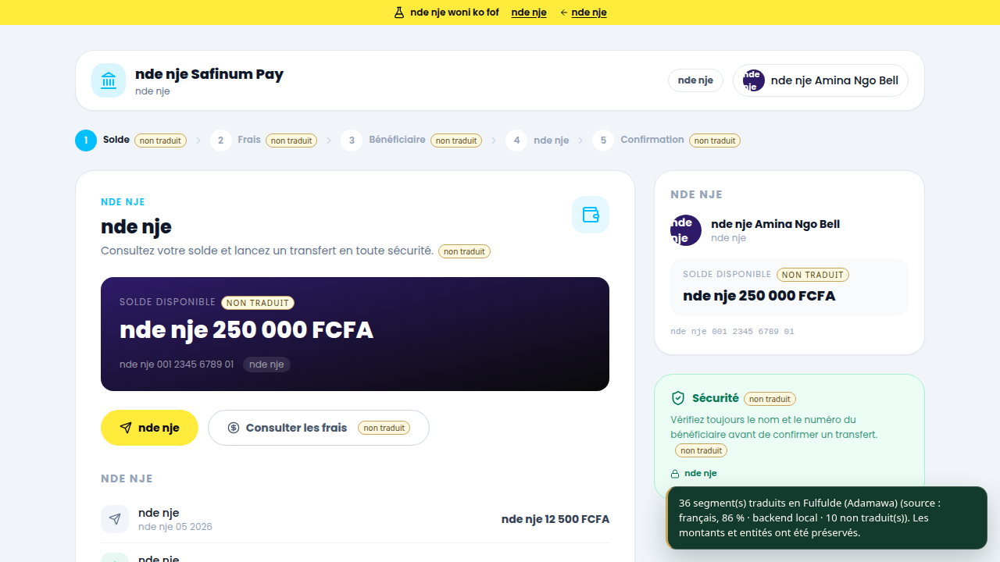

# Test navigateur M7 — site officiel SAFINUM

**Date** : 8 novembre 2026
**Cible** : `https://safinum.cm/hackathon-test` (Vue 3 + Inertia, données fictives)
**Navigateur** : Chrome for Testing 158.0.8127.18, piloté par Playwright 1.65, mode headless
**Statut** : Chrome validé ; Firefox reste à tester.

## Ce qui a été testé

Parcours complet en cinq étapes, puis bascule FR/EN :

1. Solde
2. Frais
3. Bénéficiaire (avec l'alerte `SECURITY_001` du site)
4. Récapitulatif
5. Confirmation

À chaque étape : traduction en fulfulde, contrôle des montants, noms,
téléphone et référence, vérification que les boutons du site ne sont pas
désactivés, puis restauration de l'original.

## Méthode

- Copie de test de l'extension avec `https://safinum.cm/*` ajouté aux
  `host_permissions` : elle reproduit l'autorisation `activeTab` accordée par
  un clic réel. **Le code de l'extension est inchangé.**
- Content script injecté dans l'onglet du site, puis messages
  `NK_TRANSLATE_PAGE` / `NK_RESTORE`.
- Backend local de test (mock, hors dépôt) qui répond `ok: true` et conserve
  les jetons. Ce n'est **ni NLLB ni un pack validé** : les cibles sont des
  chaînes de test, pas des traductions de production.
- Aucune donnée réelle : les données affichées par le site sont fictives.

## Résultats

| Étape | Segments traduits | Niveau A non traduit | Montants vérifiés | Références vérifiées |
|---|---:|---:|---:|---:|
| 1 — Solde | 36 | 10 | 6 | 0 |
| 2 — Frais | 29 | 12 | 5 | 0 |
| 3 — Bénéficiaire | 23 | 11 | 1 | 0 |
| 4 — Récapitulatif | 29 | 13 | 4 | 1 |
| 5 — Confirmation | 28 | 11 | 4 | 1 |
| EN — étape 1 | 45 | 1 | 6 | 0 |

Contrôles communs, tous passés :

- `pageerror` et `console.error` : **0** ;
- montants, noms, téléphone et référence : **préservés** ;
- valeurs des champs `input`/`select` : **inchangées** ;
- boutons du site : même nombre, mêmes états `disabled` (aucun bouton
  désactivé par l'extension) ;
- restauration : texte normalisé identique à l'original après `NK_RESTORE` ;
- aucune erreur Vue de type `removeChild` ou hydration.

## Badge « non traduit »

Le niveau A non traduit est marqué par `data-nk-untranslated="A"` et un badge
CSS `::after` provisoire (or `#C9A45C`). Vérifié dans Chrome :

```text
getComputedStyle(el, "::after").content === "\"non traduit\""
background: rgb(255, 248, 225) ; color: rgb(92, 74, 18)
```

Le badge et le style sont retirés par `NK_RESTORE`. Freedy peut remplacer le
style sans changer le marqueur.



*Capture avec backend mock : les textes traduits sont des chaînes de test, pas
des traductions de production.*

## Défaut trouvé et corrigé

Le premier passage a montré que la référence `SAF-2026-OMMWS3` était perdue :
elle n'était pas tokenisée, donc le moteur remplaçait aussi ses lettres.
Correctif : les références de la forme `SAF-2026-XXXX` sont maintenant
tokenisées comme entités opaques (`[[NAME_n]]`) dans
`extension/languages.js` et `extension/content.js`, puis restaurées à
l'affichage. Tests ajoutés dans `scripts/test-extension.js` et
`tests/content.test.js`.

## Limites

- Le backend utilisé est un **mock** : ce test prouve la compatibilité DOM/Vue,
  pas la qualité linguistique.
- Les packs fulfulde/ewondo/duala restent vides ; aucune phrase validée n'a été
  utilisée.
- **Firefox n'a pas été testé** : le Firefox Snap du poste ne peut pas créer
  son profil (système de fichiers en lecture seule) et `web-ext run` n'accepte
  pas `--headless` dans la version disponible.
- Les iframes et Shadow DOM fermés ne sont pas couverts ici : voir M12.
- Le harnais (script Playwright + mock) est local et non versionné ; il dépend
  d'un Chrome for Testing téléchargé dans `.cache/`.
